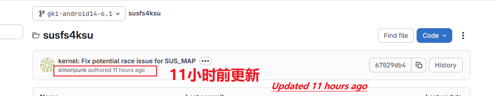
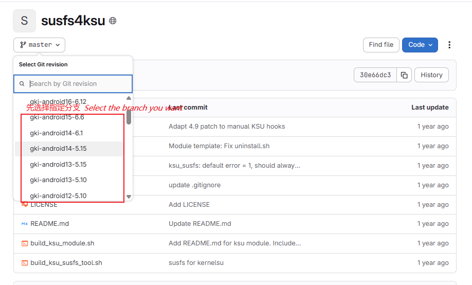
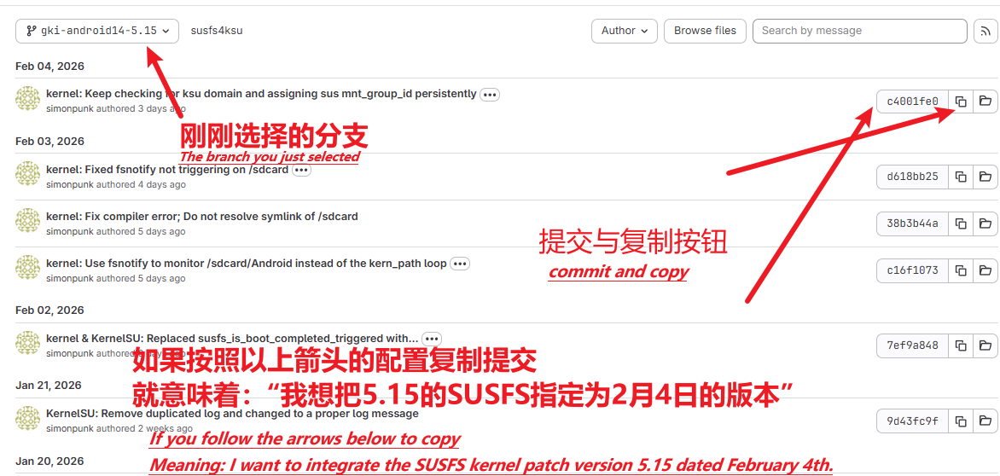

<div align="center">

# GKI KernelSU SUSFS
### 🏮 2026 🐎 Happy New Year! 🏮

**Automated GKI Kernel Builds | KernelSU + SUSFS Integrated**

[](https://github.com/zzh20188/GKI_KernelSU_SUSFS/releases)
[](http://www.coolapk.com/u/11253396)
[](https://kernelsu.org/)
[](https://gitlab.com/simonpunk/susfs4ksu)

English | [**简体中文**](README.md)

---

</div>

## 🚀 Quick Navigation

<table>
<tr>
<td align="center" width="33%">📖 <b><a href="https://github.com/zzh20188/GKI_KernelSU_SUSFS/wiki">Documentation</a></b></td>
<td align="center" width="34%">📥 <b><a href="https://github.com/zzh20188/GKI_KernelSU_SUSFS/releases">Downloads</a></b></td>
<td align="center" width="33%">🔰 <b><a href="https://github.com/zzh20188/GKI_KernelSU_SUSFS/wiki/Fork%E4%B8%8E%E8%87%AA%E5%AE%9A%E4%B9%89%E7%BC%96%E8%AF%91%E6%8C%87%E5%8D%97">Beginner Custom Build Guide</a></b></td>
</tr>
</table>

---

## ⚠️ Compatibility Notice

> **Note:** OnePlus ColorOS 14/15 is currently not supported. A data wipe may be required after flashing.

> **KernelSU: integrates the latest source from the official [tiann/KernelSU](https://github.com/tiann/KernelSU) `main` branch, keeping the upstream official kernel release name (no custom suffix).**
>
> **No KPM: neither the defconfig nor the shipped image contains KPM support.**

> **Android 16: Android 16 - 6.12 kernel version is now supported**


---

## 📚 Documentation & Guides

For detailed instructions, please refer to the [**GitHub Wiki (bilingual CN/EN)**](https://github.com/zzh20188/GKI_KernelSU_SUSFS/wiki)

Wiki covers:
- [**🔰 Beginner's Guide**](https://github.com/zzh20188/GKI_KernelSU_SUSFS/wiki/Fork%E4%B8%8E%E8%87%AA%E5%AE%9A%E4%B9%89%E7%BC%96%E8%AF%91%E6%8C%87%E5%8D%97)
- 📥 Download / Flash kernel
- 💡 Tips & Tricks
- 🆘 Brick Recovery Guide
- 📊 Kernel Version Compatibility

---

## ❗ Common Build Failure Cause (KernelSU / SUSFS Out of Sync)

The kernel side always integrates the **official KernelSU**, while SUSFS follows the branch matching your Android/kernel version. When the two update at different paces, builds may fail:

- KernelSU main branch: <https://github.com/tiann/KernelSU/commits/main>
- SUSFS branches: <https://gitlab.com/simonpunk/susfs4ksu>

For example: SUSFS just changed its kernel patch layout, but the KernelSU-side patch has not caught up yet — patching/compiling will likely fail.

In such cases, wait for upstream (KernelSU or SUSFS) to finish adapting, or pin a known-good SUSFS commit via `config/config` below.



## 🔧 Custom Commit Pinning
Use the [`config/config`](config/config) file to pin SUSFS to specific commits (KernelSU always tracks the official `main` HEAD and cannot be pinned).

**What is a commit?**

A commit is a hash string representing the state of a repository at a specific point in time. For example, setting `gki-android14-6.1` to `4b8644515fe6d87a109129e590ccd9d33a855dca` means using the SUSFS revision from that point in time.

**Why pin a commit?**

- When upstream updates introduce bugs or compatibility issues, you can roll back to a stable version
- When KernelSU and SUSFS versions are out of sync causing build failures, you can manually specify compatible versions

**How to get a commit hash?**

- SUSFS: https://gitlab.com/simonpunk/susfs4ksu/commits/

Select the branch first, then copy the commit hash:




```ini
# Enable custom commits
custom=true

# SUSFS commit hash per branch
gki-android12-5.10=
gki-android13-5.10=
gki-android13-5.15=
gki-android14-6.1=
gki-android15-6.6=
gki-android16-6.12=
```

> Empty value = use the latest commit of that branch.

---

## 🧪 Spoof `/proc/config.gz` (Stock Config)

This is an advanced trick and requires no workflow toggle.  
The build process auto-detects whether `config/stock_defconfig` exists: if present, it is applied; if absent, it is skipped.

How to use:
1. Make sure your device is running stock ROM + stock kernel.
2. Obtain `/proc/config.gz` from your device (phone-side or PC-side workflow both work).
3. Decompress it, rename it to `stock_defconfig`, upload it to the [`config/`](config/) directory in your repo, and commit (can be done directly on phone).

During the build, the workflow will automatically:
- Copy it to `$KERNEL_ROOT/common/arch/arm64/configs/stock_defconfig`
- In `$KERNEL_ROOT/common/kernel/Makefile`, switch the `$(obj)/config_data` rule from `$(KCONFIG_CONFIG)` to `arch/arm64/configs/stock_defconfig`
- Make `/proc/config.gz` in the built kernel closer to your stock kernel config
---

## 🛠️ Post-Install Recommendations

### 📦 Recommended Modules

<table>
<tr>
<th>Module</th>
<th>Repository</th>
<th>Channel</th>
</tr>
<tr>
<td><b>LSPosed-Irena</b></td>
<td><a href="https://github.com/re-zero001/LSPosed-Irena">GitHub</a></td>
<td><a href="https://t.me/lsposed_irena">Telegram</a></td>
</tr>
<tr>
<td><b>Zygisk Next</b></td>
<td><a href="https://github.com/Dr-TSNG/ZygiskNext">GitHub</a></td>
<td rowspan="2"><a href="https://t.me/real5ec1cff">Telegram</a></td>
</tr>
<tr>
<td><b>TrickyStore</b></td>
<td><a href="https://github.com/5ec1cff/TrickyStore">GitHub</a></td>
</tr>
</table>

### 🔧 Xposed Modules

| Module | Description |
|:---:|:---|
| **FuseFixer** | [Unicode zero-width fix module](https://t.me/real5ec1cff/268) |

### App

| Name | Description |
|:---:|:---|
| **Scene** | [Official Site](https://omarea.com/#/) |
---

<div align="center">

**More content coming soon...**

⭐ If this project helps you, please give it a Star!

</div>
